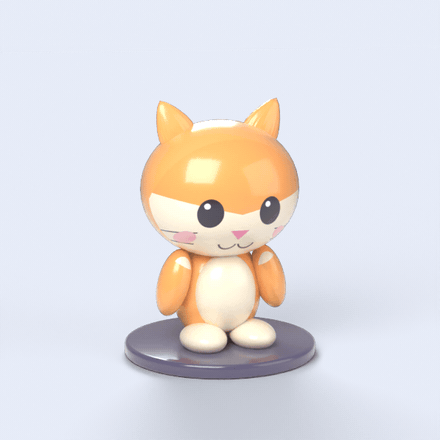
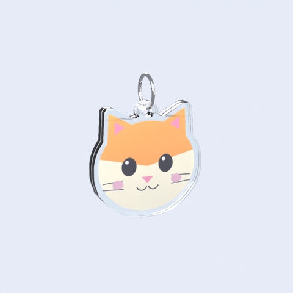

# blender-studio

[](https://github.com/shadowtor/blender-studio/actions/workflows/test.yml) [](LICENSE)

**An Agent Skill for building 3D products, mockups and animations in Blender with your AI agent.** It drives your live Blender through [MCP for Blender](https://github.com/ahujasid/blender-mcp). You bring artwork, sizes and a description; it builds the model, looks at its own renders, and hands back a 3D file, a still, an animation or an interactive web page. Tested with Claude Code. The installer also targets Codex CLI, Gemini CLI, and rules-based agents such as Cursor and GitHub Copilot.

 

<sub>Two examples built by the skill from one piece of artwork: a vinyl figurine and an acrylic keychain in an exploded view. Scripts, files and renders are in [`examples/`](examples).</sub>

**Website:** [shadowtor.github.io/blender-studio](https://shadowtor.github.io/blender-studio/) (interactive 3D versions of both examples)

**Contents:** [What it makes](#what-it-makes) · [Deliverables](#deliverables) · [Install](#install) · [Use](#use) · [Examples](#examples) · [Limits](#what-it-will-not-do) · [Develop](#develop) · [Help](#help-and-status) · [Credits](#credits)

## What it makes

| Product | How | Status |
|---|---|---|
| **Acrylic keychains and die-cut merch** | Traces your PNG's outline, adds a border and a keyring tab with a hole, stacks clear acrylic layers around the printed sheet, hangs a split ring | Tested, [example](examples/acrylic-keychain) |
| **Vinyl figurines and designer toys** | Blockout from primitives, glossy vinyl with a clear coat, your artwork printed on the surface, turntable | Tested, [example](examples/vinyl-figurine) |
| **Exploded views** | One `explode()` call spreads the layers and brings them back | Tested, part of the keychain |
| **Interactive 3D web pages** | GLB export plus a single-file orbit-and-zoom viewer | Tested, used on the website |
| **Apparel and merch mockups** | Your artwork projected onto a garment, mug, tote, tag or box mesh | Decal helper tested on the figurine; no full example yet |
| **Process animations** (a 3D printer making a part) | Layer-by-layer reveal under a gantry | Helper written, not yet exercised end to end |

It also takes whatever you describe that is not on this list; the recipes are starting points, not limits.

## Deliverables

The skill asks what you want out before it builds, because that decides how it is finished.

| You ask for | You get |
|---|---|
| **A model** | `.glb` for web and AR, `.stl` for printing, `.obj` `.fbx` `.usd`, and the `.blend` |
| **A render** | PNG stills, transparent or on a backdrop, at the size you name |
| **An animation** | PNG sequence, MP4 or GIF: exploded view, turntable, process clip |
| **A web page** | The GLB plus a `<model-viewer>` page you can embed |

Long renders run in a separate background Blender, so yours stays usable and the MCP connection cannot time out.

## Install

You need Blender 3.0 or newer with **MCP for Blender** set up, Python 3.8+, and an agent that reads skills folders. ffmpeg is needed only for GIF and MP4.

**1. MCP for Blender** (once): install [uv](https://docs.astral.sh/uv/), run `uvx mcp-for-blender setup`, then in Blender press N in the 3D viewport, open the **MCP for Blender** tab and click **Start MCP Server**. Details are in [its README](https://github.com/ahujasid/blender-mcp).

**2. The skill**, one of:

### A. Claude Code plugin marketplace

```text
/plugin marketplace add shadowtor/blender-studio
/plugin install blender-studio@blender-studio
```

### B. Installer script

```bash
git clone https://github.com/shadowtor/blender-studio.git
cd blender-studio
python tools/install.py --claude --codex      # or --gemini
python tools/install.py --rules               # Cursor, Copilot, Windsurf: run inside your project
python skills/blender-studio/scripts/check_setup.py
```

Other options: `--project`, `--dest <folder>`, `--link`, `--uninstall`. Manual alternative: copy `skills/blender-studio` into your agent's skills folder. Start a **new session** afterwards. `python tools/package_skill.py` builds `dist/blender-studio.zip` for UIs that take a skill upload.

### C. Let your AI agent install it

```text
Install the "blender-studio" Agent Skill for me.

1. Clone https://github.com/shadowtor/blender-studio (or git pull if I already have it) and read
   docs/INSTALL-FOR-AGENTS.md in it. Follow that file exactly.
2. Install it for the agent I am using right now. Only copy the skills/blender-studio folder.
3. Run: python skills/blender-studio/scripts/check_setup.py. If it reports a FAIL, show me the line and stop.
4. Tell me where it was installed and that I must start a new session. Do not commit, push or download anything else.
```

## Use

Open Blender with the MCP server running, then ask your agent:

> Make an acrylic keychain from the attached logo, 55 mm wide, 3 mm clear acrylic with a 2 mm border and a hole for a ring. I want a hero render and a short exploded-view GIF for the Kickstarter page.

It confirms the deliverable and any sizes it lacks, builds, shows you renders, then exports. More requests that work:

- "Turn this character sheet into a vinyl figurine, 100 mm tall, and give me a turntable GIF and a GLB for the site."
- "Put our logo on a black tee and a white mug, front view, on a plain backdrop."
- "Explode this product into its layers and make a 4 second looping video."
- "Show a 3D printer building this part, 10 seconds, for the campaign video."
- "The border is too thin, make it 3 mm": one parameter changes and it re-renders.

## Examples

Both were produced end to end by the skill in a live Blender 5.2.

**[`acrylic-keychain`](examples/acrylic-keychain)**

| Check | Result |
|---|---|
| Parts | Back acrylic, printed sheet, front acrylic, chrome split ring |
| Size | 51.0 x 51.7 x 3.0 mm per layer, 0 open edges |
| Files | `keychain.glb`, `keychain.blend`, `exploded.gif`, `exploded.mp4`, `hero.png` |
| **Not proven** | How real acrylic and printed colours look. Ask for a manufacturer proof |

**[`vinyl-figurine`](examples/vinyl-figurine)**

| Check | Result |
|---|---|
| Parts | 11 objects, all closed meshes, 68 x 73 x 95.6 mm overall |
| Files | `figurine.glb`, `figurine.blend`, `turntable.gif`, `hero.png` |
| **Not proven** | Moulding. It is a blockout of overlapping parts, not a union mesh with wall thickness and draft |

## What it will not do

- Slice, send to a printer, or promise a factory will match the render.
- Read exact dimensions off a photo. It asks you.
- Simulate fabric reliably. Garment mockups need a garment mesh (yours, from an asset library, or generated) and use a projected print, not cloth physics.
- Work without Blender running with the MCP server started.
- Use your artwork anywhere but your own Blender. `generate_3d` sends a prompt or image to a third party and can cost credits, so the skill asks first.

## Develop

```bash
python tools/smoke_test.py          # checks the skill files, scripts compile, and (if Blender is installed) a headless build
python tools/package_skill.py       # dist/blender-studio.zip
python tools/build_site.py          # _site/, then: python -m http.server -d _site 8000
python examples/art/make_art.py     # redraws the sample artwork (needs Pillow)
```

See [`CONTRIBUTING.md`](CONTRIBUTING.md) and [`docs/architecture.md`](docs/architecture.md).

## Help and status

Questions and bugs go in [issues](https://github.com/shadowtor/blender-studio/issues). This is a one-person project in active use, so expect a reply within a week or so, not a day. Security problems: see [`SECURITY.md`](SECURITY.md). Contributions: [`CONTRIBUTING.md`](CONTRIBUTING.md). Everyone taking part follows the [code of conduct](CODE_OF_CONDUCT.md).

## Credits

Built on [ahujasid/blender-mcp](https://github.com/ahujasid/blender-mcp) (MCP for Blender, MIT), which provides the connection to Blender. The skill structure follows the same pattern as the sibling `fusion-studio` skill. The web viewer uses Google's [`<model-viewer>`](https://modelviewer.dev/) (Apache 2.0). Not affiliated with the Blender Foundation. Blender is a trademark of the Blender Foundation.

MIT licence, see [`LICENSE`](LICENSE).
